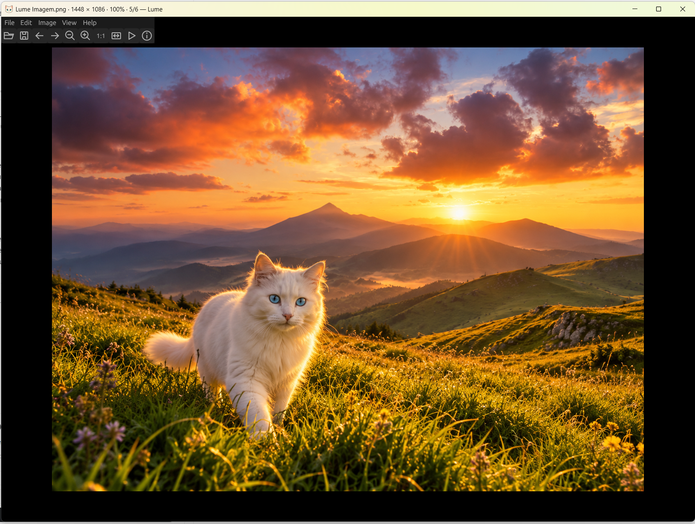

# Lume

A minimalist image viewer written in Rust, inspired by IrfanView. Lume focuses on fast folder navigation and simple image cropping for wallpapers, with support for JPEG, PNG, WebP, AVIF, GIF, BMP, TIFF, HEIC, ICO and CBZ comics.



## Download

Download **Lume-Setup.exe** from the [latest release](https://github.com/flavw/Lume/releases/latest). The current Windows build is 64-bit. The installer is unsigned, so Windows SmartScreen may show an unrecognized-app warning.

## Features

- Fast native decoding of JPEG, PNG and WebP, asynchronous loading and a bounded image cache.
- Minimal text menus; toolbar enabled by default and optional status bar.
- Original-size viewing, seven zoom modes, fullscreen and slideshow.
- Wallpaper crops: Free, 1:1, 16:9, 9:16, 10:16, 8:16, original and custom aspect ratios; rule-of-thirds grid and resizable handles.
- Lossless JPEG cropping and rotation through jpegtran. Numbered copies preserve the source; imperfect rotations are rejected.
- JPEG and WebP export at quality 80 by default, configurable quality, and lossless PNG export.
- AI generation metadata inspection and copying, including supported Stable Diffusion parameters and ComfyUI JSON stored in PNG, JPEG and WebP metadata.
- AI metadata reading and copying.
- Image information, clipboard images, rename with separate extension field, file copying/moving and deletion confirmation.
- CBZ comic reading, basic image adjustments, undo/redo and unsaved-change confirmation.
- Dark, light, system and customizable neon themes; English and Portuguese interfaces.

## Quick controls

| Key | Action |
| --- | --- |
| Left / Right | Previous / next image |
| Ctrl+O | Open an image |
| Enter / F | Toggle fullscreen |
| 1–7 | Choose a zoom mode |
| Ctrl or Alt + mouse wheel | Zoom |
| I | Image information and AI metadata |
| P | Preferences |
| F2 | Rename |
| Ctrl+S | Save dialog |
| Ctrl+P | Windows Print Pictures |
| S | Export JPEG |
| Ctrl+Y | Apply the crop |
| Delete / Shift+Delete | Recycle / permanently delete, with confirmation |
| F1 | All shortcuts |

Without modifiers, the mouse wheel navigates images or scrolls vertically in the width-fit reading mode. The default zoom fits large images to the window without enlarging small ones. The last image opens a restart dialog unless automatic restart is enabled.

## Build from source

Install Rust and your platform's native build tools, then run:

```sh
cargo build --release --bin lume
```

The Windows build also needs a resource compiler (`windres` for the GNU toolchain). The shipped Windows release is tested; Linux support is present in the source but has not yet been validated as a release.

JPEG/PNG/WebP viewing uses native libraries. Additional formats such as AVIF and batch conversion use ImageMagick on demand; lossless JPEG operations use jpegtran. These tools are bundled with the Windows installer. For a source build, install them on PATH, place them under `tools/`, or set `LUME_MAGICK` and `LUME_JPEGTRAN` to their executable paths. They are not required for native-format navigation.

```sh
cargo test --bin lume
cargo clippy --bin lume -- -D warnings
```

## License and AI assistance

Lume's own source code and assets are dedicated to the public domain under **CC0 1.0 Universal**. See [LICENSE](LICENSE). Third-party libraries and bundled tools retain their respective licenses; see [THIRD_PARTY_LICENSES.txt](THIRD_PARTY_LICENSES.txt) and their accompanying notices.

This project was programmed with AI assistance. AI tools were also used to create the cat icon. Lume is an independent project and is not affiliated with IrfanView.
